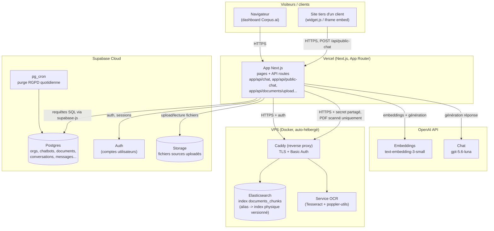
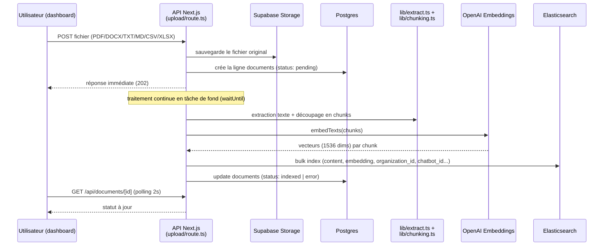
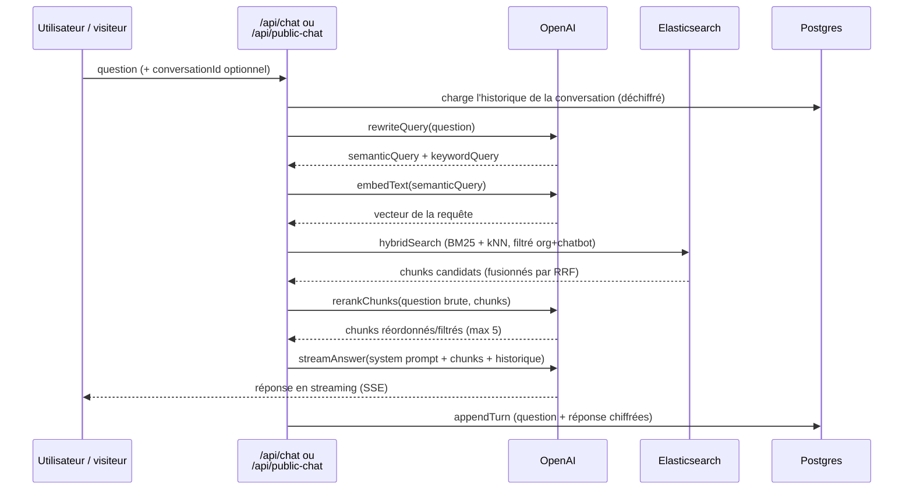

# Architecture

Vue d'ensemble des composants, des bases de données et des flux de données.
Référence technique — pour le guide de mise en prod, voir `docs/deployment.md`.

## Composants et topologie de déploiement cible

**Pourquoi un VPS pour Elasticsearch et pas un service managé** : décision
actuelle pour rester sur deux fournisseurs (Supabase + OpenAI) plutôt que
trois ; un ES managé (Elastic Cloud) reste une option si l'auto-hébergement
devient un fardeau opérationnel. Voir `docs/deployment.md` pour le
compose de prod (sécurité activée, contrairement à `docker-compose.yml`
qui est dev-only).

## Bases de données et ce qu'elles contiennent

| Store | Rôle | Contenu | Notes |
|---|---|---|---|
| **Postgres (Supabase)** | Source de vérité métier, multi-tenant | `organizations`, `chatbots`, `documents` (métadonnées), `conversations`/`messages` (chiffrés en AES-256-GCM), `custom_templates`, `users_organizations` | RLS sur toutes les tables, scopées par `organization_id` (directement ou via jointure). Voir `supabase/migrations/`. |
| **Supabase Storage** | Fichiers sources uploadés | PDF/DOCX/TXT/MD/CSV/XLSX bruts, à `{organization_id}/{chatbot_id}/{document_id}-{filename}` | RLS basée sur le 1er segment du chemin. Pas le contenu indexé — juste l'original, pour re-traitement éventuel. |
| **Elasticsearch** | Index de recherche hybride | `documents_chunks` (alias) → chunks de texte + vecteurs d'embedding (1536 dims), `organization_id`/`chatbot_id`/`document_id` en `keyword` | **Pas de RLS native** — l'isolation multi-tenant est appliquée à la main dans `lib/elasticsearch.ts` (filtre obligatoire sur `organization_id` + `chatbot_id` à chaque requête). Point critique à ne jamais contourner. Analyseur français (stemming) depuis l'item 39 du roadmap. |
| **Service OCR** | Fallback OCR pour les PDF scannés (`ocr-service/`, item 7 du roadmap) | Ne stocke rien — reçoit un PDF, renvoie le texte reconnu (Tesseract), rien de persisté côté service | Appelé uniquement quand `lib/extract.ts` détecte un PDF sans texte natif. Optionnel : non configuré, un tel PDF est simplement rejeté. Secret partagé (`OCR_SERVICE_SECRET`), pas de RLS applicable (pas de base de données). |

## Flux : ingestion d'un document

## Flux : question dans le chat (RAG)

## Isolation multi-tenant — récapitulatif

- **Postgres** : RLS sur chaque table, scopée par `organization_id`.
- **Storage** : policy RLS sur le chemin (`{organization_id}/...`).
- **Elasticsearch** : aucune RLS native — filtre applicatif obligatoire
  (`organization_id` + `chatbot_id`) dans `hybridSearch`,
  `deleteDocumentChunks`, `deleteOrganizationChunks`. Toute nouvelle route
  qui touche l'index doit respecter ce filtre.
- **Chiffrement applicatif** : `content`/`sources` des messages chiffrés en
  AES-256-GCM avant insertion Postgres (`lib/crypto.ts`) — protège même
  contre un accès direct avec la clé service-role.
